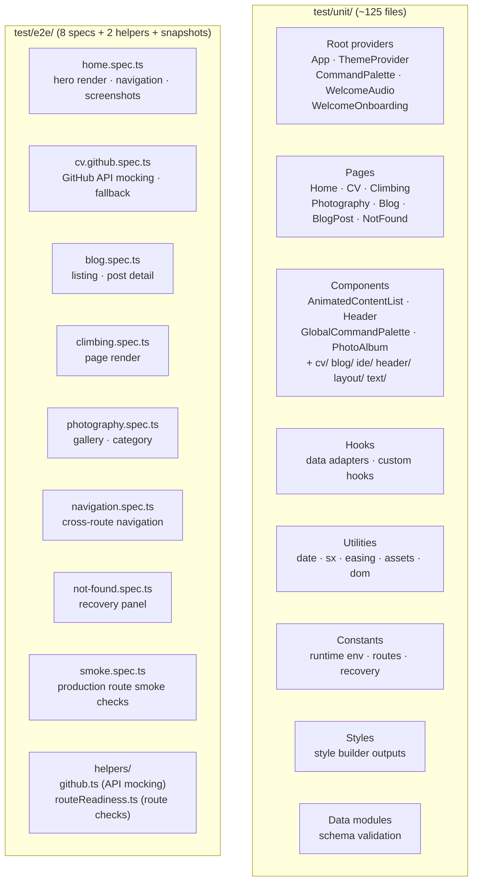
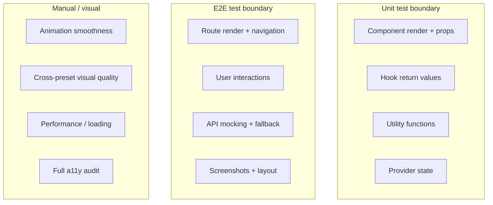

# Testing Strategy

This document covers the actual test organization, harness patterns, and coverage priorities in this repository.

## Test infrastructure

| Layer              | Framework                         | Location     | Run command                            |
| ------------------ | --------------------------------- | ------------ | -------------------------------------- |
| Unit / component   | Jest + React Testing Library      | `test/unit/` | `CI=true npm test -- --watchAll=false` |
| End-to-end         | Playwright (Chromium + mobile WebKit) | `test/e2e/`  | `npm run test:e2e`                     |
| Build verification | Vite production build             | —            | `npm run build`                        |

### Jest configuration

- Test root: `test/unit/` (configured in `jest.config.cjs`)
- Pattern: `**/*.test.{ts,tsx}`
- Transformer: `ts-jest` via `jest.config.cjs`
- Setup: `src/setupTests.ts` provides:
  - `@testing-library/jest-dom` matchers
  - `window.matchMedia` polyfill for responsive/media-query code
  - Custom `IntersectionObserver` stub that synchronously reports elements as intersecting (so animated content is visible during tests)

### Playwright configuration

- Test directory: `test/e2e/`
- Projects: `chromium` for route/browser coverage, `smoke` for desktop production
  coverage, and `mobile-chromium` / `mobile-webkit` for focused production asset
  coverage using Pixel 7 and iPhone 13 device settings
- Serves production build on port 3100 via `serve -s build -l 3100`
- Shared worker count is owned by `playwright.config.ts` (currently 4); docs, workflows, and nested instructions should rely on that default unless a job intentionally overrides it
- Mobile WebKit runs the asset spec sequentially within its project because
  concurrent original-photo recovery cases create unnecessary memory pressure.
  Other projects still use the shared worker pool.
- Retries: 2 in CI, 0 locally
- Build variant: `npm run build:e2e` sets `REACT_APP_RUNTIME_ENV=test` for the Chromium Playwright bundle and any test-runtime-specific behavior
- Standard command shapes:
  - full local suite: `npm run test:e2e`
  - chromium project: `npm run build:e2e && npm run test:e2e:chromium`
  - smoke project: `npm run build && npm run test:e2e:smoke`
  - headed debugging for chromium coverage: `npm run test:e2e:headed`
  - UI runner for chromium coverage: `npm run test:e2e:ui`
  - specific chromium spec: `npm run build:e2e && npm run test:e2e:chromium -- test/e2e/<spec>.ts`
  - specific smoke spec: `npm run build && npm run test:e2e:smoke -- test/e2e/smoke.spec.ts`
  - asset delivery across all three production browser configurations: `npm run build && npm run test:e2e:assets`
  - mobile asset projects only: `npm run build && npm run test:e2e:mobile`
  - actual `PUBLIC_URL=/portfolio` deployment: `npm run test:e2e:assets:subpath`
- Install both Chromium and WebKit with `npx playwright install --with-deps chromium webkit`.
  The subpath runner stages a temporary deployment, needs port 3100 free, cleans up,
  and restores the normal build even on test failure.
- CI currently runs the build asset gate and desktop coverage. Enabling the mobile
  projects and subpath run in CI requires a workflow-authorized maintainer to apply
  `plans/cv-photography-workflow.patch` and publish the workflow update. The patch
  also installs WebKit and separates the browser-cache keys.

## Media and bundle gates

- `npm run media:generate` regenerates display images and their manifest after source-photo changes; see the root README for the recipe and budgets.
- `npm run media:check` verifies that committed display files match current source hashes and size limits.
- Both build variants automatically run `npm run assets:check` to verify CV PDF and
  media signatures and exact build/source equality. The inventory is derived from
  CV/photography data and the generated display manifest.
- `npm run assets:check -- --url https://host/base` audits a completed deployment's
  real response bodies, MIME types, source equality, and PDF ranges. It downloads
  originals as well as derivatives; use the matching checkout and expect substantial
  network transfer. A 200 HTML rewrite is a failure, not an asset success.
- `npm run build && npm run check:bundle` validates the complete eager JavaScript import graph (950 KB raw / 300 KB gzip), preventing chunk renaming from hiding growth.
- `test/e2e/quality.spec.ts` covers font validity across all presets/modes, article contrast, narrow album layout and keyboard lightbox return, page landmarks, reveal actions, metadata navigation, and motion off/reduced behavior.

## Validation ownership

This document is the canonical source for:

- repo-standard Playwright, Jest, and build command shapes
- build-variant requirements such as `npm run build:e2e`
- change-type validation expectations referenced by `AGENTS.md`, `CONTRIBUTING.md`, and scoped instruction files
- browser-validation expectations for UI-affecting changes

When another instruction file says to validate a change, it should point here rather than restating the full matrix or command list.

## Validation matrix

| Change type                            | Required validation                                                                                                                     |
| -------------------------------------- | --------------------------------------------------------------------------------------------------------------------------------------- |
| Data module only                       | `npm run build` + targeted route or consumer validation                                                                                 |
| Page-level UI                          | `npm run build` + browser validation on the changed route                                                                               |
| Shared component                       | `npm run build` + browser validation on a primary consumer and at least one additional consumer when reuse is clear                     |
| Motion/animation                       | `npm run build` + validation with motion intensity `off` + browser validation                                                           |
| Theme/styling                          | `npm run build` + browser validation in both light and dark modes; when shared appearance treatment changes, check at least two presets |
| Route/navigation/not-found             | `npm run build` + direct-navigation check + relevant Playwright route coverage when present                                             |
| Runtime-environment-sensitive behavior | `npm run build:e2e` + relevant Playwright or targeted validation                                                                        |
| GitHub-backed CV/fallback data         | `npm run build` + mocked `/cv` success/failure coverage when present + browser validation                                               |
| Asset-path or media-path change        | `npm run build` + `npm run test:e2e:assets` + `npm run test:e2e:assets:subpath`                                                            |

### Browser validation expectations

- Use sandboxed Playwright for route rendering, layout inspection, and screenshots when UI is affected; `playwright.config.ts` explicitly enables `chromiumSandbox`.
- On Ubuntu 23.10+ hosts, where `kernel.apparmor_restrict_unprivileged_userns=1`, the sandbox needs the Chromium-only AppArmor profile from `.github/actions/playwright-sandbox`. CI's `e2e` and `smoke` jobs apply it automatically. Do not switch to `--no-sandbox` or disable the restriction globally.
- Validate the smallest set of affected routes first, then expand to another consumer when a shared component or layout primitive changed.
- Check at least one narrow/mobile viewport and one desktop viewport for layout-affecting edits.
- When Playwright E2E coverage exists for the touched behavior, run the narrowest relevant spec after the appropriate build variant.
- Use `npm run build:e2e` before Playwright Chromium coverage when the touched behavior depends on the test runtime.
- Prefer mocked `/cv` coverage over live GitHub API-dependent validation when that workflow is available.
- If browser tooling is unavailable, run the narrowest fallback validation and report browser validation as deferred.
- Close browser sessions when validation is finished.
- Asset browser coverage checks actual `%PDF-` downloads from both resume controls,
  certificate click requests plus PDF response bodies, byte-range responses, and
  decoded album covers/tiles/lightbox images. It scrolls lazy images into view rather
  than confusing offscreen images with load failures, and uses reduced motion to
  isolate asset delivery from animation timing. Original-image recovery is exercised
  with both 404 and 200 HTML derivative responses; these UI-only fault tests block
  service workers so interception is deterministic.
- Production worker smoke tests separately verify real worker control, offline-cache
  behavior, and that missing PDFs stay errors instead of becoming HTML shells.
- Mobile WebKit emulation does not reproduce the native iOS PDF viewer. Before a
  release, also validate both PDF controls and photography on physical Safari,
  including an existing worker-controlled session and a fresh session.

## Test organization



## Unit test patterns

### Component tests

Components are tested with `render()` + `screen` from React Testing Library. Key patterns:

- **Mock dependencies** via `jest.mock()` for child components, hooks, and imports
- **ThemeProvider wrapper** for any component that needs theme context
- **Data attributes** (`data-testid`, `data-delay`, `data-component-is-tilt`) for prop assertions in mocked children
- **Proxy render** in mocked components to capture and assert on passed props

### Provider tests

Root providers are tested for:

- Context value defaults
- State update behavior (toggle, set)
- localStorage persistence (read on mount, write on change)
- Child rendering

### Hook tests

Data hooks are tested for:

- Correct data transformation from source modules
- Sorting, filtering, and lookup behavior
- Edge cases (empty data, missing slugs)
- Deterministic ordering (e.g., blog tags sorted by frequency with alphabetical tie-break)

### Utility tests

Pure functions in `src/utils/` have straightforward input → output test suites.

## E2E test patterns

### Route specs

Each route spec covers:

- Page render and basic content visibility
- Navigation from the route
- Key interactive behavior (if applicable)
- Screenshot comparison (home page)

### GitHub API mocking

`test/e2e/helpers/github.ts` provides `page.route()` intercepts for GitHub API responses:

- Success state (mocked profile + contributions data)
- Error state (simulated API failure)
- Validates that fallback content renders when the API fails

### Route readiness

`test/e2e/helpers/routeReadiness.ts` provides helpers to wait for route-specific signals before asserting (e.g., waiting for data to load, animations to settle).

## What kinds of behavior are protected

### Currently tested

| Category                       | What's covered                                                                 | Test layer       |
| ------------------------------ | ------------------------------------------------------------------------------ | ---------------- |
| Provider state                 | Theme toggle, appearance, motion intensity, audio consent, palette state       | Unit             |
| Route rendering                | All 6 routes render expected content                                           | Unit + E2E       |
| Component APIs                 | Props, conditional rendering, data-driven content                              | Unit             |
| Data hooks                     | Sorting, lookup, transformation, edge cases                                    | Unit             |
| GitHub fallback                | Success and error API states, fallback rendering                               | E2E              |
| Runtime environment resolution | `REACT_APP_RUNTIME_ENV` override and `NODE_ENV` fallback behavior              | Unit (constants) |
| CV story mode                  | Story mode activation, scroll progress, active-section tracking, exit controls | Unit             |
| Not-found recovery             | Recovery panel renders with contextual suggestions                             | Unit + E2E       |
| Animation component contracts  | Delay props, tilt flag, visibility callbacks                                   | Unit             |
| Style builder outputs          | Builder functions execute without error against theme                          | Unit             |

### Not currently tested (gaps)

| Category                                    | Why it matters                                                                  | Recommended approach                              |
| ------------------------------------------- | ------------------------------------------------------------------------------- | ------------------------------------------------- |
| Motion intensity visual regression by level | Verifies off/subtle/default/expressive remain visually correct across routes    | E2E screenshot comparison per intensity level     |
| Theme appearance preset visual regression   | Verifies all 6 presets keep rendering quality across routes and color modes     | E2E screenshot comparison across presets and mode |
| Full cross-route accessibility audit        | Catches keyboard/focus/semantics issues outside the currently targeted helpers  | Periodic manual or automated a11y sweeps          |
| Performance budget enforcement              | Prevents route and shared-bundle growth from regressing initial-load experience | CI size budget or Lighthouse/WebPageTest gate     |

## Testing motion-heavy features

Motion is the highest regression risk in this codebase. Key principles:

### Test behavior, not cosmetics

- Assert that animated components become visible (the `IntersectionObserver` stub ensures this in unit tests)
- Assert that `delayMs` and stagger props are passed correctly
- Assert that `skipEntranceAnimation` and `visible` overrides work
- Do not assert on specific pixel positions or keyframe values

### Test the scaling contract

- Verify that components respect `useMotionScale()` — when motion is `off`, elements should render instantly
- Verify that `prefers-reduced-motion` forces the `off` scale

### Test interaction state machines

- Tab open/close transitions
- Accordion expand/collapse
- Story mode scroll progress + active-section transitions
- IDE window state changes (normal → minimized → expanded)

### Use the IntersectionObserver stub

`src/setupTests.ts` stubs `IntersectionObserver` to synchronously report intersection. This means:

- Viewport-triggered animations fire immediately in tests
- You don't need to scroll or wait for intersection
- Tests see the final visible state, not the hidden initial state
- Story-mode tests can simulate multiple intersecting sections in one callback to verify deterministic active-section selection

## Testing boundaries



## Regression risks specific to this codebase

| Risk                    | What breaks                                                               | How to catch it                                       |
| ----------------------- | ------------------------------------------------------------------------- | ----------------------------------------------------- |
| Broken motion handoffs  | Typewriter doesn't start, sections never reveal                           | E2E route specs + unit delay prop tests               |
| Tab/drawer lifecycle    | Content stays mounted when it should unmount, re-render flicker           | Unit tests with state toggling                        |
| Route transition issues | Blank pages during navigation, stale content                              | E2E navigation tests                                  |
| Theme drift             | Hardcoded colors/spacing bypass theme, look broken on preset switch       | Unit style builder tests + E2E visual regression      |
| Component API breaks    | Changed prop names or defaults affect multiple consumers                  | Unit tests per component + consumer integration tests |
| Composition breakage    | Shared primitives render incorrectly when composed together               | Unit render tests with full ThemeProvider wrapper     |
| Route exposure drift    | Header, command palette, and smoke expectations disagree on public routes | Unit route-registry tests + production smoke coverage |

## Running tests

```bash
# Unit tests (all)
CI=true npm test -- --watchAll=false

# Unit tests (specific file)
CI=true npm test -- --watchAll=false --testPathPatterns=AnimatedContentList

# Build verification
npm run build

# E2E tests (full local suite; rebuilds between chromium and smoke)
npm run test:e2e

# E2E tests (chromium project)
npm run build:e2e
npm run test:e2e:chromium

# E2E tests (production smoke project)
npm run build
npm run test:e2e:smoke

# E2E tests (headed chromium debugging)
npm run test:e2e:headed

# E2E tests (specific chromium spec)
npm run build:e2e
npm run test:e2e:chromium -- test/e2e/cv.github.spec.ts

# E2E tests (specific smoke run)
npm run build
npm run test:e2e:smoke
```

**Note:** The October 2026 stale CV expectations have been repaired. The full unit suite is expected to pass; distinguish any new baseline drift from regressions with current evidence.

## Further reading

- [Agent guide](agent-guide.md) — validation expectations for agents making code changes
- [App architecture](../architecture/app-architecture.md) — route definitions for understanding test coverage mapping
- [Motion architecture](../frontend/motion-architecture.md) — intensity scaling contract that tests must respect
